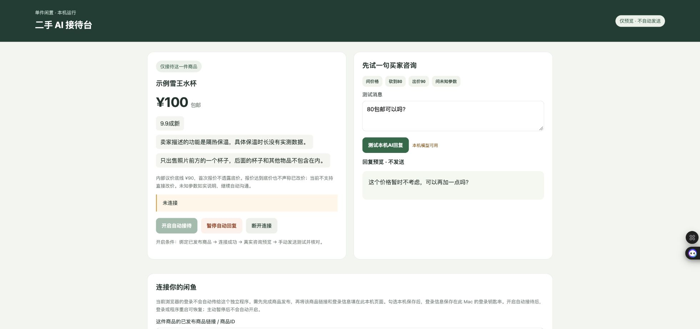

# 二手 AI 自动接待台

在自己的 Mac 或 Windows 电脑上运行，用本机 AI 理解买家问题，再依据你填写的商品事实与价格规则回复。单账号、单商品，免费开源，中文操作页面。

> **实验性社区项目，非闲鱼官方产品。** 使用非官方网页协议，平台更新可能使连接失效。支持 **macOS / Windows 10、11 + Python 3.12 + Ollama**；Linux 尚未提供完整安装支持。这个仓库不包含作者账号、Cookie、买家消息、商品照片或模型权重。



## 能做什么

- 理解问价、议价、运费、成色及常见商品问题；报价不得低于你设置的底价。
- 先预览一条真实咨询，核对发送后再开启自动接待。
- 未确认的材质、容量、发货时间等如实说明；AI 不自行编造参数。
- 保存消息去重记录，短暂断线后重连，定期续期；发送结果不确定时暂停，避免重复发出。
- 可选将登录保存到 macOS 登录钥匙串或 Windows 当前用户 DPAPI 加密存储；可选当前用户登录后自启。
- 主动暂停保持暂停。商品状态不明、付款/售出或登录需验证时停止自动出售回复。

**不包含：** 自动发布商品、自动改价、发货、退款、跨平台、多账号、多商品、云托管或手机独立运行。商品发布需先在闲鱼完成。AI 在这个版本主要负责分类，最终答复来自受约束规则，并不是无限制的生成式客服。

## Windows 安装

查看 [Windows 安装与后台运行](docs/WINDOWS.md)：解压后双击 `install-windows.bat`，填写配置，再双击 `start-windows.bat`。Windows 无需编译苹果钥匙串工具。

## macOS 快速安装

1. 安装 [Python 3.12](https://www.python.org/downloads/) 和 [Ollama](https://ollama.com/download)。启动 Ollama，下载模型：

   ```bash
   ollama pull qwen3:4b-instruct-2507-q4_K_M
   ```

2. 下载本仓库 ZIP 并解压，或克隆仓库。建议放在 `~/Projects/ershou-ai-reception`，不要放在共享/同步文件夹。进入项目目录：

   ```bash
   python3.12 -m venv .venv
   .venv/bin/python -m pip install -r requirements.txt
   cp config.example.json config.local.json
   ```

3. 编辑 `config.local.json`，填写自己的 `seller_id`、已发布的 `item_id` 和全部商品信息。所有示例信息都必须核实；不知道的项目写“未确认”。不要把 Cookie 填入这个文件。

   - `seller_id`：自己已登录闲鱼账号 Cookie 中的 `unb` 数字值，仅填数字，不是昵称。
   - `item_id`：商品详情链接中 `id=` 后面的数字。
   - `price` 是标价，`min_price` 是私有底价；都不会实际修改闲鱼商品价格。
   - `shipping`、`condition`、`scope` 以及其他事实字段会直接进入回答，请准确填写。
   - `port` 默认 `8942`；本机已有程序占用时换另一个端口。
   - `model` 可换为自己安装的、支持 JSON 输出的 Ollama 模型，但需重新验证效果。

4. 先启动前台版本：

   ```bash
   .venv/bin/python app.py
   ```

   打开 [本机接待台](http://127.0.0.1:8942/)。若修改了端口，使用自己的端口。未建立 `config.local.json` 时只能演示，不能连接真实账号。

5. 先测试本机回复，再按 [连接与首次验收](docs/CONNECT.md) 绑定账号。默认是预览模式，不会自动发消息；真实测试核对后再点“开启自动接待”。

## macOS 可选：保存登录和后台运行

仅内存连接不需要钥匙串工具，关闭进程即失去登录。需要保存登录时：

```bash
# 只需第一次安装苹果命令行开发工具（可能弹系统安装窗口）
xcode-select --install
# 已安装开发工具则直接执行：
.venv/bin/python build_keychain.py
```

在接待台勾选“将此账号登录保存到本机钥匙串”，连接并完成真实测试后开启自动接待。系统若询问钥匙串访问或文稿访问，请自行确认用途后选择。不要开放给所有应用。

停止前台程序后，选择以下一种运行方式：

```bash
# 手动启动后台守护程序
.venv/bin/python manage.py start

# 或安装当前用户登录自启（仅这一个程序）
.venv/bin/python manage.py install
.venv/bin/python manage.py start
```

自启任务名为 `com.ershoureception.opensource`，只支持一个安装目录。一份配置只绑定一个账号和一件商品。更改账号/商品前应在页面撤销旧登录，停止程序，再改配置并重新编译工具；不要在两个目录同时安装。

电脑需要已登录、保持唤醒、联网，钥匙串可用。关闭浏览器不等于停止程序；休眠期间不能接待。没有固定 55 分钟限制，但平台要求登录或验证码时仍需正常处理，不能承诺永不掉线。

## 暂停、退出和卸载

- 页面“暂停自动回复”会保存暂停选择；“断开连接”同时暂停。
- 页面“移除保存登录并禁用自启”移除当前配置对应的钥匙串登录并停用自启。
- 彻底停止：`.venv/bin/python manage.py stop`。即使服务暂时不可达，也会保存停用标记。
- 再次启动后需重新手动开启接待；停机前旧消息不会批量重发。
- 卸载：先撤销登录、执行停止命令，再删除 `~/Library/LaunchAgents/com.ershoureception.opensource.plist` 和本项目文件夹。共享的 Ollama 不会被停止或卸载。

异常说明见 [排查指南](docs/TROUBLESHOOTING.md)。

## 隐私和使用边界

本机模型在 `127.0.0.1:11434` 运行，无需填写云模型密钥。接待台只监听本机回环地址，校验来源和页面令牌，不应通过反向代理或端口转发开放到公网。

Cookie 具有账号权限，只能粘贴在自己的本机页面。运行记录保存在 `data/`，可能包含买家咨询；`config.local.json`、`data/`、日志、环境和编译产物均被 Git 忽略。提交问题时不要附带这些文件或原始抓包。

请仅使用自己有权操作的账号，并自行确认平台规则。不提供验证码绕过、批量骚扰、账户共享或成交保证。

## 开发与验证

```bash
.venv/bin/python -m pytest -q
```

测试使用伪造身份和临时数据库，不向真实买家发送消息。测试覆盖价格边界、配置隔离、消息去重、断线/发送不确定、重启恢复及暂停撤销等；并不证明每个账号都能连接平台。参见 [架构](docs/ARCHITECTURE.md) 和 [发布范围](SPEC.md)。

本项目源自单商品实测工具；作者本机原版有真实收发和后台恢复验证，公开配置版在发布前进行了离线回归和本机页面验证。你的账号仍需独立完成首次真实收发验收，整机重启及不同硬件环境不能视作已实测。

## 许可与致谢

以 **GPL-3.0** 提供完整源码，可免费使用、修改和按许可证再分发。许可证全文见 [LICENSE](LICENSE)，协议研究来源和修改说明见 [NOTICE.md](NOTICE.md)。Ollama、模型及 Python 依赖由各自作者提供，按各自许可分发；本仓库不打包这些组件。
